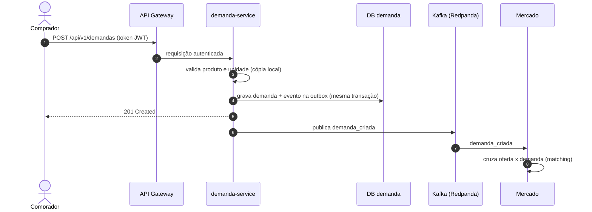

# Compra e Demanda | Portal B2B Distribuído

Microsserviço de **Demanda** do Portal B2B Distribuído, trabalho da disciplina de **Sistemas Distribuídos (2026)**.

O comprador registra o que precisa comprar (produto, quantidade, destino, prazo, preço máximo). O serviço guarda essa
demanda e **avisa o resto do sistema por eventos Kafka (Redpanda)**, para que o serviço de Mercado faça o cruzamento
entre oferta e demanda.

---

## Sumário

1. [Situação atual](#1-situação-atual)
2. [Contexto: o Portal B2B](#2-contexto-o-portal-b2b)
3. [Responsabilidades do grupo](#3-responsabilidades-do-grupo)
4. [Fluxo principal](#4-fluxo-principal)
5. [Eventos Kafka](#5-eventos-kafka)
6. [API REST](#6-api-rest-proposta)
7. [Modelo de dados](#7-modelo-de-dados-proposta)
8. [Conceitos de sistemas distribuídos aplicados](#8-conceitos-de-sistemas-distribuídos)
9. [Integração com os outros grupos](#9-integração-com-os-outros-grupos)
10. [Como rodar](#10-como-rodar)
11. [Estrutura do repositório](#11-estrutura-do-repositório)
12. [Decisões em aberto](#12-decisões-em-aberto)
13. [Integrantes](#13-integrantes)
14. [Documentação](#14-documentação)

---

## 1. Situação atual

| Item | Situação |
|---|---|
| Estrutura do repositório e documentação inicial | Pronto |
| Contratos dos eventos (JSON Schema + exemplo) | Pronto (proposta, em validação com o grupo de Mercado) |
| Serviço no ar com endpoint de saúde (`/saude`) | Pronto (esqueleto) |
| Ambiente Docker (Postgres, Redpanda, serviço) | Esqueleto, valores provisórios |
| API de demandas (criar, listar, consultar, cancelar) | Planejado |
| Publicação de `demanda_criada` com outbox | Planejado |
| Consumo de `produto_cadastrado` | Planejado |
| Demanda recorrente (agendador + `demanda_recorrente_gerada`) | Planejado |
| Idempotência, retry e DLT | Planejado |
| Previsão, alertas, reposição, orçamento | Dependem de decisão (ver [seção 12](#12-decisões-em-aberto)) |

> Esta tabela reflete o estado real do repositório. O que está como "Planejado" ainda não foi implementado.

---

## 2. Contexto: o Portal B2B

Portal de compra e venda entre empresas, construído como **microsserviços orientados a eventos**, usando Kafka como
plataforma de streaming. Cada grupo da turma cuida de um ou mais serviços.

| # | Serviço | Grupo responsável |
|---|---|---|
| 1 | Usuários / Acesso | Autenticação |
| 2 | Produtos | Fornecimento e Produtos |
| 3 | Fornecimentos | Fornecimento e Produtos |
| **4** | **Demanda** | **Compra e Demanda (este repositório)** |
| 5 | Mercado (matching engine) | Mercado, Negociação/Leilão e Pedidos |
| 6 | Negociação / Leilão | Mercado, Negociação/Leilão e Pedidos |
| 7 | Pedidos | Mercado, Negociação/Leilão e Pedidos |
| 8 | Logística / Frete | Logística/Transporte |
| 9 | Transportadoras | Logística/Transporte |

Grupos transversais: **Banco de Dados**, **Infraestrutura** (Kafka, Docker, gateway), **Teste** e **UX/UI** (frontend).

**Posição da Demanda no fluxo de negócio:** é a porta de entrada das necessidades de compra. Depois que a demanda é
registrada e publicada no Kafka, o Mercado calcula oferta versus demanda e define o modo de negociação.

---

## 3. Responsabilidades do grupo

### Escopo confirmado (vem do diagrama de arquitetura)

- Cadastro de **demanda única**
- Cadastro de **demanda recorrente** (frequência e quantidade)
- Geração das ocorrências de demandas recorrentes
- Publicação dos eventos `demanda_criada` e `demanda_recorrente_gerada`
- Banco de dados próprio (schema `demanda`)

### Levantado pelo grupo, ainda em definição

| Responsabilidade | Situação |
|---|---|
| Análise e previsão de demanda | Em aberto: definir profundidade |
| Avaliação de necessidade de reposição | Em aberto: depende de o serviço consumir `estoque_atualizado` |
| Geração de alertas de alta/baixa demanda | Em aberto: via evento Kafka; envio de notificação é de "Sistemas Externos (futuro)" |
| Acompanhamento de status de compra | Parcial: status do pedido é do grupo de Pedidos (`pedido_atualizado`) |
| Controle de orçamento de compras | Em aberto: não aparece no diagrama |
| Relatórios e histórico de compras | Parcial: histórico de **demandas** é nosso; pedidos são do grupo de Pedidos |

### Fora do escopo do grupo

Processamento e gestão de pedidos (serviço 7), matching (serviço 5), negociação (serviço 6), logística, autenticação e telas.

---

## 4. Fluxo principal



Para demandas recorrentes, um agendador interno gera cada ocorrência no período definido e publica
`demanda_recorrente_gerada`.

---

## 5. Eventos Kafka

Todos os eventos usam um envelope comum e a chave da mensagem é o `aggregateId`.

### Publicados

| Evento | Quando | Consumidor |
|---|---|---|
| `demanda_criada` | Uma demanda é criada | Mercado |
| `demanda_recorrente_gerada` | Uma demanda recorrente gera uma nova ocorrência | Mercado |
| `demanda_cancelada` (proposto) | Uma demanda é cancelada | Mercado |

### Consumidos

| Evento | Origem | Uso |
|---|---|---|
| `produto_cadastrado` | Fornecimento e Produtos | Manter cópia local de produtos para validar demandas |
| `produto_atualizado`, `produto_excluido` | Fornecimento e Produtos | Propostos, ainda sem tópico definido |
| `estoque_atualizado` | Fornecimento | A confirmar (necessário para reposição) |
| `pedido_atualizado` | Pedidos | A confirmar (necessário para status de compra) |

### Exemplo: `demanda_criada`

```json
{
  "eventId": "9a1e5c70-2b3d-4c8f-a6e1-0d4f7b2c9e31",
  "eventType": "demanda_criada",
  "eventVersion": "1.0",
  "timestamp": "2026-11-10T15:00:00.000Z",
  "source": "demanda-service",
  "correlationId": "e5f4d3c2b1a09f8e7d6c5b4a39281706",
  "aggregateId": "dem-120",
  "payload": {
    "demandaId": "dem-120",
    "compradorId": "emp-12",
    "produtoId": "prod-1",
    "unidade": "L",
    "quantidade": 5000,
    "precoMaximo": 4.80,
    "destino": { "cidade": "Goiânia", "uf": "GO" },
    "prazoDesejado": "2026-11-30T23:59:59Z",
    "tipo": "UNICA",
    "frequencia": null,
    "criadoPor": { "empresaId": "emp-12", "usuarioId": "usr-3" },
    "criadoEm": "2026-11-10T15:00:00.000Z"
  }
}
```

Campos de todos os eventos, JSON Schemas e exemplo completo: [`docs/03-eventos-e-integracoes.md`](docs/03-eventos-e-integracoes.md)
e [`comum/contratos/`](comum/contratos/).

> O campo `destino` existe porque a Logística precisa de origem e destino da entrega. A origem vem do fornecimento;
> o destino só pode vir da demanda do comprador.

---

## 6. API REST (proposta)

| Método | Rota | Descrição |
|---|---|---|
| POST | `/api/v1/demandas` | Cria uma demanda (única ou recorrente) |
| GET | `/api/v1/demandas` | Lista as demandas do comprador |
| GET | `/api/v1/demandas/{id}` | Consulta uma demanda |
| DELETE | `/api/v1/demandas/{id}` | Cancela uma demanda |
| GET | `/saude` | Verificação de saúde do serviço (**já implementado**) |

Regras: o comprador é identificado **pelo token JWT** (nunca pelo corpo da requisição); escopo exigido: `BUYER`.

---

## 7. Modelo de dados (proposta)

Schema `demanda`, a ser combinado com o grupo de Banco de Dados.

| Tabela | Função |
|---|---|
| `demanda` | Dados da demanda: tipo, produto, quantidade, unidade, destino, prazo, preço máximo, frequência, status |
| `produto_referencia` | Cópia local dos produtos, alimentada por `produto_cadastrado` (o serviço não lê o schema de outro grupo) |
| `outbox` | Eventos a publicar, gravados na mesma transação da demanda |
| `processed_events` | `eventId` já processados, para idempotência |

---

## 8. Conceitos de sistemas distribuídos

Pontos previstos para a implementação e para o relatório:

- **Comunicação assíncrona por eventos:** o serviço de Demanda não chama o Mercado diretamente; publica no Kafka.
- **Banco por serviço:** cada microsserviço tem seu schema; dados de outros serviços são replicados por evento.
- **Padrão Outbox:** o evento é gravado na mesma transação da demanda, evitando perder eventos se o broker cair.
- **Idempotência:** tabela `processed_events` impede processar a mesma mensagem duas vezes.
- **Ordem de eventos:** ao consumir atualizações, descartar eventos mais antigos que o último aplicado.
- **Tolerância a falhas:** retry (3 tentativas com espera crescente) e fila de mensagens mortas (`demanda.dlt`).
- **Consistência eventual:** a cópia local de produtos pode estar levemente atrasada em relação ao serviço de Produtos.

> Parte dessas regras foi repassada por um membro do grupo a partir do kit de infraestrutura da turma e deve ser
> conferida no `contrato-eventos.md` oficial antes de implementar.

---

## 9. Integração com os outros grupos

| Grupo | Relação | O que precisamos combinar |
|---|---|---|
| Mercado, Negociação/Leilão e Pedidos | Consome nossos eventos | Campos de `demanda_criada` e `demanda_recorrente_gerada`; evento de cancelamento; repasse do `destino` à Logística |
| Fornecimento e Produtos | Fornecemos validação com os eventos deles | Tópicos de atualização/exclusão de produto; se consumimos `estoque_atualizado` |
| Autenticação | Token JWT | Algoritmo (HS256 ou RS256), issuer, audience, claim `tenant_id` |
| Infraestrutura | Kafka, gateway, Docker | Porta, schema, tópicos, `demanda.dlt`, rotas |
| Banco de Dados | Schema `demanda` | Quem escreve o DDL |
| UX/UI | Telas | Cadastro, lista e alertas de demanda |
| Teste | QA | Endpoints e payloads de exemplo |
| Logística/Transporte | Indireta, via `pedido_criado` | Garantir que o destino chegue até eles |

---

## 10. Como rodar

Requisitos: Docker Desktop aberto.

```bash
cp .env.example .env        # ajuste as senhas se quiser
docker compose up -d --build
docker compose ps           # aguarde ficar healthy/running
```

Verificar o serviço: http://localhost:8104/saude

Testes unitários, sem Docker:

```bash
cd services/demanda-service
python -m venv .venv
pip install -r requirements.txt pytest httpx
pytest
```

Derrubar tudo e apagar os dados:

```bash
docker compose down -v
```

> Portas, usuário e senha do banco são **provisórios** e precisam ser alinhados com o `portal-b2b-kit-infra`.

---

## 11. Estrutura do repositório

```
.
├── README.md
├── docker-compose.yml            # ambiente de desenvolvimento
├── .env.example
├── comum/                        # código compartilhado: envelope de eventos, JWT, erros
│   └── contratos/                # JSON Schemas e exemplos dos eventos
├── services/
│   └── demanda-service/
│       ├── demanda/              # código do serviço (FastAPI)
│       ├── migracoes/            # tabelas do schema demanda
│       └── tests/
├── infra/                        # Postgres, tópicos, gateway
├── testes_integracao/            # cenários contra o ambiente no ar
└── docs/
    ├── 01-contexto-e-escopo.md
    ├── 02-arquitetura.md
    ├── 03-eventos-e-integracoes.md
    ├── 04-plano-de-trabalho.md
    ├── 05-pauta-de-decisoes.md
    ├── contratos/                # propostas enviadas a outros grupos
    └── especificacoes/           # especificações para o grupo de Teste
```

---

## 12. Decisões em aberto

As principais (lista completa em [`docs/05-pauta-de-decisoes.md`](docs/05-pauta-de-decisoes.md)):

1. **"Compra" no nome do grupo:** o diagrama só tem o serviço de Demanda. Cobrimos também orçamento, histórico e status de compra, ou só Demanda?
2. **Entregáveis do trabalho:** código rodando, documentação, relatório, apresentação, testes?
3. **Profundidade** de previsão de demanda e alertas.
4. **Obrigatoriedade** de outbox, DLT, retry e JSON Schema.
5. **Mercado:** os campos propostos nos eventos atendem? Precisam de `demanda_cancelada`?
6. **Fornecimento:** a Demanda deve consumir `estoque_atualizado`?
7. **Autenticação:** HS256 ou RS256.

---

## 13. Integrantes

| Nome |
|---|
| Lucca Stuart |
| Gabriel Martins |
| Matheus Caetano |
| Daniel Junior Teixeira |
| Gabriel Whinter |

---

## 14. Documentação

| Documento | Conteúdo |
|---|---|
| [01 Contexto e escopo](docs/01-contexto-e-escopo.md) | O que é de Demanda, o que não é, o que está em aberto |
| [02 Arquitetura](docs/02-arquitetura.md) | Serviço, banco, eventos e API |
| [03 Eventos e integrações](docs/03-eventos-e-integracoes.md) | Payloads, tópicos e o que pedir a cada grupo |
| [04 Plano de trabalho](docs/04-plano-de-trabalho.md) | Etapas e divisão de tarefas |
| [05 Pauta de decisões](docs/05-pauta-de-decisoes.md) | Perguntas para a turma e para o professor |
